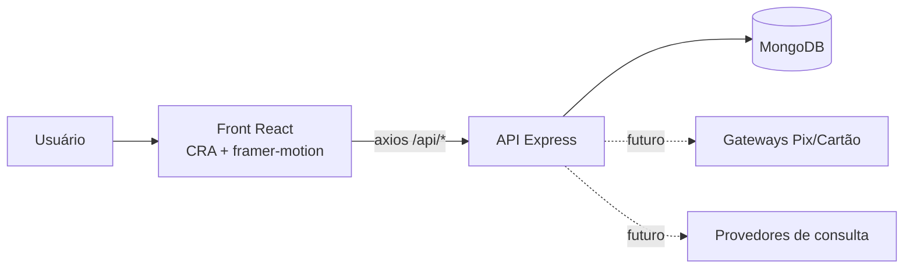

<div align="center">

# Consultas Online — protótipo 2025

**Plataforma de consultas com saldo pré-pago: o usuário recarrega, escolhe um produto de consulta e recebe o resultado.**


</div>

> Este repositório é o **primeiro esboço (julho/2025)** do que depois virou o [HubData](https://github.com/WelisonLira/hubdata-com): um motor de consultas com carteira pré-paga para correspondentes bancários. Está preservado como registro histórico — a arquitetura, os modelos de dados e as ideias de produto nasceram aqui.

## O que ele faz

| Funcionalidade | Onde está |
|---|---|
| Cadastro, login e JWT | `backend/routes/authRoutes.js`, `backend/middlewares/authenticateJWT.js` |
| Carteira pré-paga (recargas, saldo, cupons) | `backend/models/Recarga.js`, `Cupom.js`, `routes/recargaRoutes.js` |
| Catálogo de produtos de consulta e débito de saldo | `backend/models/Produto.js`, `routes/consultaRoutes.js` |
| Histórico de consultas | `GET /api/consulta/historico` |
| Consentimento LGPD, auditoria e rate limit | `backend/middlewares/lgpdConsent.js`, `auditoriaLogger.js`, `rateLimiter.js` |
| Indicações, FAQ, depoimentos, tickets de suporte, notificações | `backend/models/*` |
| Backup agendado do banco | `backend/jobs/backupJob.js` (node-cron) |
| Front React com dark mode, i18n (pt/en/es) e animações | `frontend/src/` |
| Documentação da API | `backend/docs/swagger.yaml` |

## Arquitetura



## Estrutura

```
projeto12/
├── backend/               # API Express + Mongoose
│   ├── app.js             # bootstrap, segurança (helmet, cors, rate limit), rotas
│   ├── models/            # 11 schemas: Usuario, Produto, Consulta, Recarga, Cupom, …
│   ├── routes/            # auth, produto, consulta, recarga
│   ├── middlewares/       # JWT, admin, LGPD, auditoria, rate limit
│   ├── jobs/backupJob.js  # cron de backup
│   └── docs/swagger.yaml  # OpenAPI
├── frontend/              # React (Create React App)
│   └── src/               # components, pages, context (Auth, Theme, I18n), i18n/
└── rascunhos-iniciais/    # primeira versão (consulta de placa) — só referência
```

## Rodando localmente

```bash
# backend
cd backend && cp .env.example .env   # ajuste MONGO_URI e JWT_SECRET
npm install && npm run dev            # http://localhost:4000

# frontend (outro terminal)
cd frontend && cp .env.example .env   # REACT_APP_API_URL=http://localhost:4000/api
npm install && npm start              # http://localhost:3000
```

### Variáveis de ambiente (backend)

| Variável | Para quê |
|---|---|
| `MONGO_URI` | conexão com o MongoDB |
| `JWT_SECRET` | assinatura dos tokens |
| `CORS_ORIGIN` | origem permitida do front |
| `MERCADOPAGO_ACCESS_TOKEN`, `STRIPE_SECRET_KEY`, `PAGSEGURO_*` | gateways de pagamento (não integrados) |
| `SMTP_*`, `ONESIGNAL_API_KEY`, `FIREBASE_SERVER_KEY` | e-mail e push (não integrados) |

## Limitações conhecidas

- `backend/app.js` referencia rotas (`cupom`, `faq`, `admin`, `indicacao`, `notificacao`, `suporte`, `depoimento`) cujos arquivos nunca foram escritos — o servidor só sobe se você comentar essas linhas ou criá-las.
- A consulta em si é **simulada** (`consultaRoutes.js`): debita o saldo e devolve um resultado fictício.
- Nenhum gateway de pagamento foi integrado.

Para a versão em produção dessas ideias, veja o **HubData**.

## Licença

MIT — veja [LICENSE](LICENSE).

---

<div align="center">Feito por <a href="https://github.com/WelisonLira">Welison Lira</a> · G12 Soluções Financeiras</div>
